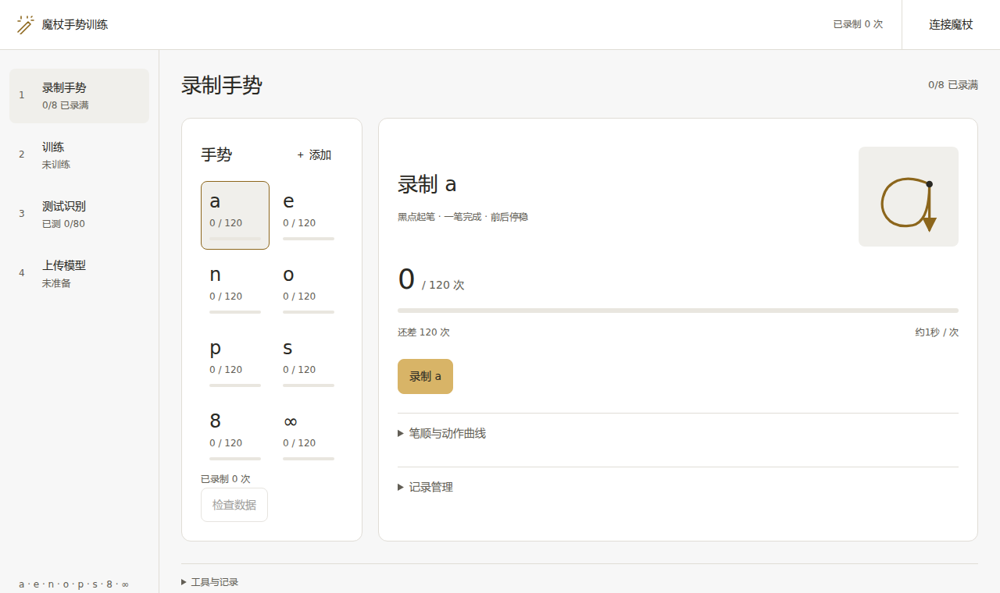

# 魔杖手势训练

在电脑上录制自己的挥杖动作，检查样本、训练模型、测试识别，再把模型上传到魔杖。整个过程集中在一个界面；手势对应的功能和灯效在魔杖网页中设置。

[下载 Windows 独立版](https://github.com/WuYuStar/MugglesWand-IR/releases/tag/v0.2.0-rc1) · [查看魔杖项目](../../README.md)



## 开始使用

1. 下载 `MugglesWand-Trainer-1.1.0-Windows-x64.zip`，完整解压。
2. 双击 `魔杖手势训练.exe`。保留同目录的 `app` 和 `runtime` 文件夹；独立版无需另外安装 Python。若系统缺少显示组件，运行包内的 `显示组件安装.exe`。
3. 录制、测试和上传时，让电脑连接魔杖热点 `Muggles' Wand`。魔杖默认地址是 `192.168.4.1`，数据端口是 `8080`。

训练记录默认保存在 `%LOCALAPPDATA%/MugglesWandTrainer`。更新或移动程序文件不会删除记录；重复启动会打开已有窗口。

## 从动作到可用的手势

| 步骤 | 在工具中完成什么 |
| --- | --- |
| 录制手势 | 默认有 a、e、n、o、p、s、8、∞ 八类，可扩展到 16 类。每类至少录制 120 条；动作保持固定笔顺，挥动前后停稳。 |
| 检查数据 | 查看疑似异常记录，决定保留还是隔离并补录。隔离前会自动备份。 |
| 训练 | 在电脑上生成 INT8 `.wandmodel` 模型；记录变化后需重新训练。 |
| 测试识别 | 用新动作检查预测结果。测试不会触发魔杖上的功能。 |
| 上传模型 | 将模型传给魔杖，等待重启后核对生效模型。断线可重连热点后重试。 |

上传后打开魔杖网页 `http://192.168.4.1`，在「配置 → 手势与灯效」给每个手势选择功能和灯效并保存。新增手势也要在这里分配功能。电脑工具只处理动作与模型。

若魔杖仍运行不支持独立模型更新的旧固件，先在魔杖网页「设备 → 系统升级」安装[本项目基础固件](https://github.com/WuYuStar/MugglesWand-IR/releases/tag/v0.2.0-rc1)。此后更新手势模型无需重新刷整套固件。

## 从源码运行

需要 64 位 Python 3.10～3.13。在 WSL 中进入本目录，安装依赖并启动本地界面：

```sh
python3 -m venv /home/codex/.venvs/wand-trainer
/home/codex/.venvs/wand-trainer/bin/python -m pip install -r requirements.txt
/home/codex/.venvs/wand-trainer/bin/python app.py
```

首次安装依赖需要联网。[模型协议](MODEL_PROTOCOL.md)说明 `.wandmodel` 格式；[桌面版说明](desktop/README.md)记录独立版组成。源码检查可运行 `python -m unittest discover -s tests`。
