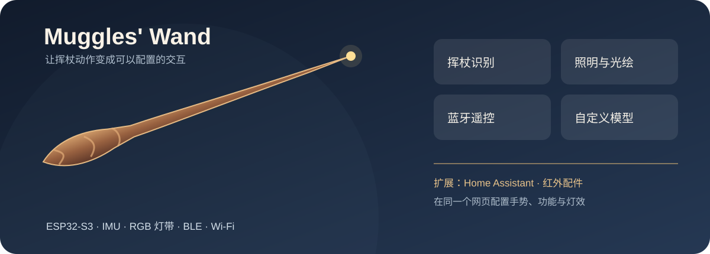
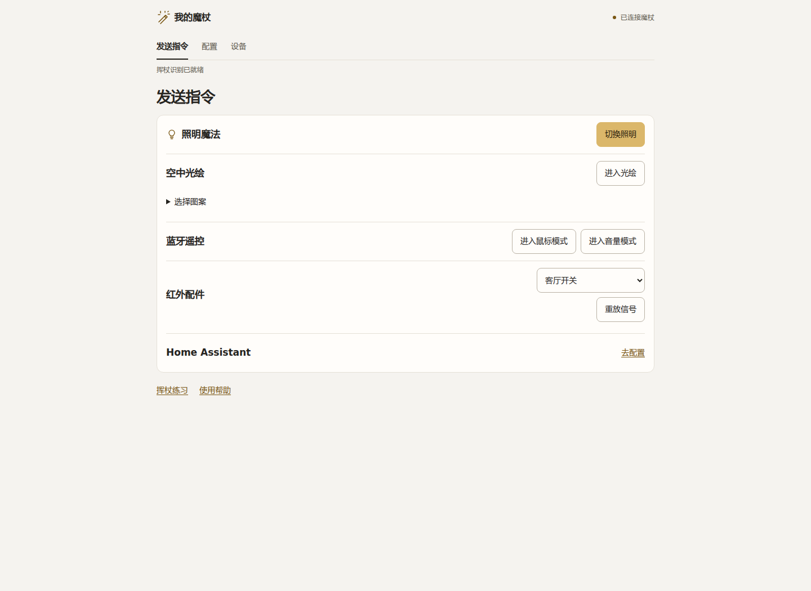
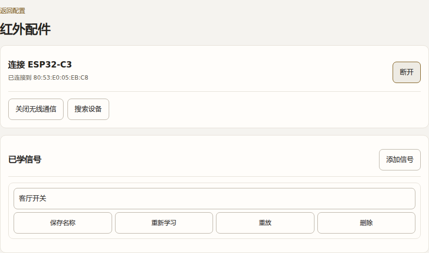

# Muggles' Wand｜可自定义的手势魔杖

用挥杖动作控制灯光、空中光绘和蓝牙设备，也能将自己的手势训练成新指令。魔杖以 ESP32-S3、六轴 IMU 和灯带为核心；连接它的 Wi-Fi 后，手机或电脑就能打开控制页面，配置手势对应的功能与灯效。



这是基于 [zoushui 的 Muggles' Wand](https://github.com/zou-shui/MugglesWand) 持续开发的版本。原项目提供魔杖硬件、外壳和基础手势能力；本版本整理了网页控制、独立模型训练、Home Assistant 配置，并新增了 ESP32-C3 红外配件。

## 魔杖能做什么

| 玩法 | 使用方式 |
| --- | --- |
| 挥杖识别 | 挥动魔杖触发已绑定的功能与灯效；在网页中调整对应关系 |
| 照明与空中光绘 | 用灯带照明，或挥动魔杖显示所选图案 |
| 蓝牙遥控 | 配对电脑或手机后，进入隔空鼠标、音量控制模式 |
| 自定义手势 | 用电脑端训练工具采集动作、训练模型并上传到魔杖 |
| 可选扩展 | 配置 Home Assistant 场景，或连接红外配件学习与重放遥控指令 |

## 第一次使用

1. **打开魔杖。** 单击底部按键开机。手机或电脑连接 Wi-Fi `Muggles' Wand`，密码 `12345678`，然后打开 `http://192.168.4.1`。
2. **先试内置功能。** 在「发送指令」中切换照明、进入光绘，或选择蓝牙遥控模式。鼠标和音量控制需要先完成蓝牙配对。
3. **练习挥杖。** 打开「挥杖练习」，选择当前模型中的手势；挥动前后停稳，尽量一笔完成。识别结果会显示在页面上。
4. **设置自己的动作。** 在「配置 → 手势与灯效」为每个手势分别选择功能和灯效，保存到魔杖。底部按键可从鼠标、音量或光绘模式返回手势识别。



> [!NOTE]
> 界面截图从本仓库的固件页面生成，连接状态和信号名称使用模拟数据。实际设备状态以你的魔杖页面为准。

### 训练属于自己的手势

[电脑端手势训练工具](3.Software/4.GestureTrainer/README.md)按“录制 → 检查数据 → 训练 → 测试 → 上传模型”的顺序工作。电脑训练模型，魔杖负责识别和执行动作；日常训练不需要重新编译整套固件。模型上传后，可以继续在魔杖网页中为新手势配置功能和灯效。

### 连接 Home Assistant

在「配置 → Home Assistant」填写网络与服务信息，再将 HA 场景分配给手势。它是可选功能；不接入 Home Assistant 时，照明、光绘、蓝牙和本地手势设置仍可使用。

## 新增功能：红外配件

ESP32-C3 Super Mini 接一只红外接收模块和一只发射模块，通过 ESP-NOW 与魔杖通信。它负责学习、保存和重放遥控器信号；魔杖负责提供页面与手势入口。


1. 给两块设备供电，在魔杖网页「配置 → 红外配件」搜索并连接 C3。
2. 点击「添加信号」，在 60 秒内对准接收头短按遥控器。学习成功后会自动保存。
3. 在列表中重放，确认受控设备有反应；随后可改名，或到「手势与灯效」中绑定。



列表只显示已学信号，可重新学习、重放和删除。C3 当前最多保存 **32 个信号**，断电后保留。魔杖也可在「发送指令 → 红外配件」中直接选择信号重放。

| 模块连接 | ESP32-C3 引脚 |
| --- | --- |
| 接收模块 OUT | GPIO7 |
| 发射模块 IN | GPIO20 |
| 模块 GND | 与 C3 共地 |
| 发射模块 VCC | 模块额定的 5V 电源 |

> [!IMPORTANT]
> C3 的 GPIO 为 3.3V 电平。5V 供电的接收模块须确认 OUT 不会向 GPIO7 输出超限电压；发射模块 IN 须支持 3.3V 控制。3W 发射模块应由合适的 5V 电源供电。详细接线见 [C3 固件文档](2.Firmware/IRLearner-C3/README.md)。

两块设备使用 ESP-NOW 信道 1。若魔杖同时连接 Home Assistant 所用 Wi-Fi，且该网络位于其他信道，页面会提示冲突。普通解调红外接收头无法测出原遥控器载波；空调长帧、长按重复和滚动码设备不保证能重放。

## 下载与开发

[下载固件 v0.1.0](https://github.com/WuYuStar/MugglesWand-IR/releases/tag/v0.1.0) · [查看固件使用说明](2.Firmware/release-ir-espnow/README.md)

| 位置 | 内容 |
| --- | --- |
| [魔杖固件源码](https://github.com/WuYuStar/MugglesWand-IR-Firmware) | ESP32-S3 固件，作为 Git 子模块管理 |
| [红外配件固件](2.Firmware/IRLearner-C3/) | ESP32-C3 固件及分区表 |
| [手势训练工具](3.Software/4.GestureTrainer/) | 采集、训练、测试和模型上传 |
| [硬件](1.Hardware/) · [外壳模型](4.Model/) | 魔杖主板与外壳资料 |

```bash
git clone --recurse-submodules https://github.com/WuYuStar/MugglesWand-IR.git
```

魔杖可通过现有升级页上传匹配的 ESP32-S3 应用固件。首次烧录新 C3 需同时写入引导程序和分区表，不能只写应用镜像。

> [!NOTE]
> 两份固件已在 WSL 编译，设备写入校验通过，魔杖可正常启动。网页交互已检查。两块板同时通电后的 ESP-NOW 连接、真实挥杖触发和不同遥控设备的兼容性仍需实测。

---

魔杖硬件、外壳和基础项目来自 [zoushui / MugglesWand](https://github.com/zou-shui/MugglesWand)。原作者版权与 MIT 许可保留在 [LICENSE](LICENSE) 和 [固件许可](2.Firmware/MugglesWand-src/LICENSE)。
