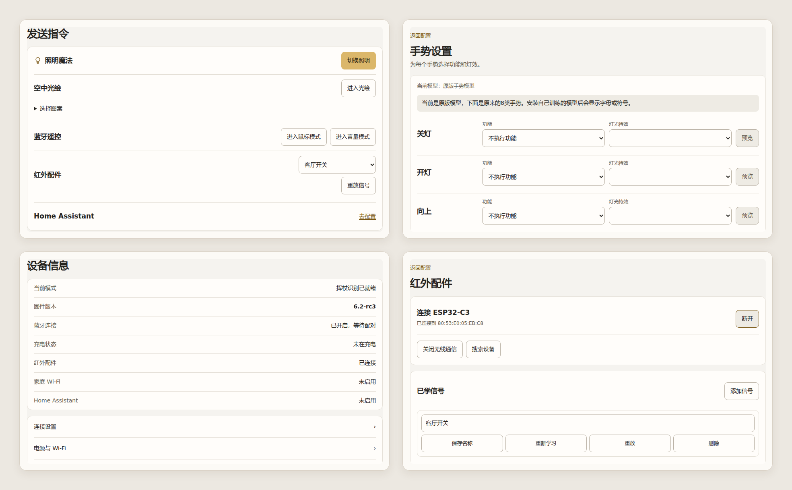
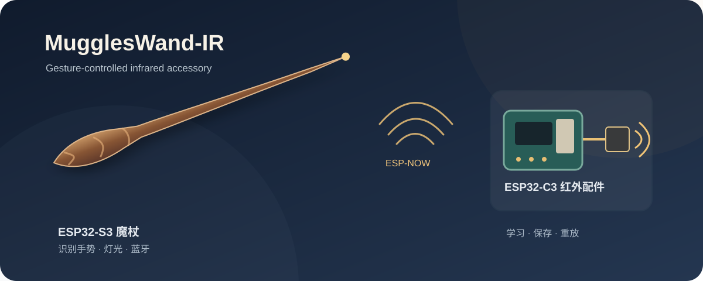

# Muggles' Wand

一根基于 ESP32-S3 和 TinyML 的手势魔杖。它识别挥杖动作，并按你保存的设置执行照明、空中光绘、蓝牙遥控或灯效。手机、电脑连接魔杖热点后，可以直接打开网页体验功能、调整手势；电脑端工具还可以录制动作并训练新模型。

本仓库基于 [zoushui 的 Muggles' Wand](https://github.com/zou-shui/MugglesWand) 扩展，保留原项目的硬件、外壳和基础固件。本版本新增独立的手势训练流程、Home Assistant 配置，以及通过 ESP-NOW 连接的红外配件。

[下载固件与训练工具](https://github.com/WuYuStar/MugglesWand-IR/releases/tag/v0.2.0-rc1) · [查看硬件资料](1.Hardware/) · [查看手势训练工具](3.Software/4.GestureTrainer/README.md)



## 功能

- **手势识别与映射：** 用魔杖内置 IMU 识别挥杖动作。在「配置 → 手势与灯效」中，为每类手势分别选择功能和灯光效果，保存后由魔杖执行。
- **照明与光绘：** 切换魔杖灯光，或在空中挥动魔杖显示所选图案。可在「配置」中把灯珠数量设为 35～45 颗，默认 39 颗。
- **蓝牙遥控：** 与电脑或手机配对后使用隔空鼠标、音量控制。
- **手势训练：** 在电脑上录制、检查和训练自己的手势，上传模型后再在魔杖网页中分配功能。训练模型不需要重新编译基础固件。
- **可选连接：** 配置 Home Assistant 场景；连接 ESP32-C3 红外配件学习和重放遥控信号。

## 开始使用

需要一根已写入本项目固件的魔杖。首次体验照明、光绘和手势识别不需要额外配件。

1. 单击魔杖底部按键开机。手机或电脑连接 Wi-Fi `Muggles' Wand`，密码 `12345678`。
2. 在浏览器打开 `http://192.168.4.1`。在「发送指令」里先试照明或空中光绘。鼠标和音量控制需要先完成蓝牙配对。
3. 打开「挥杖练习」选择一个手势。挥动前后停稳，动作尽量一笔完成；网页会显示识别结果。
4. 在「配置 → 手势与灯效」为手势选择功能和灯效，保存到魔杖。鼠标、音量与光绘模式会占用动作传感器；单击底部按键可返回手势识别。

### 训练自己的手势

[手势训练工具](3.Software/4.GestureTrainer/README.md)提供“录制 → 检查数据 → 训练 → 测试 → 上传模型”流程。电脑负责模型训练，魔杖负责实时识别、功能与灯效设置。上传模型后，回到魔杖网页给新手势分配动作。

### 配置 Home Assistant

在魔杖网页「配置 → Home Assistant」填写网络与服务信息，再在手势设置中选择 HA 场景。此功能按需启用。

## 红外配件扩展

ESP32-C3 Super Mini 连接红外接收和发射模块，与魔杖通过 ESP-NOW 通信。C3 保存学到的信号；魔杖网页负责连接、学习入口和手势绑定。



1. 给魔杖和 C3 供电，在「配置 → 红外配件」搜索并连接 C3。
2. 点击「添加信号」，在 60 秒内对准接收头短按遥控器。学习成功后自动保存。
3. 在列表中重放，确认受控设备有反应。之后可以改名、重新学习、删除，或把信号分配给手势。

列表只显示已学信号，C3 最多保存 **32 个**。也可以在「发送指令 → 红外配件」选择信号直接重放。

| 模块引脚 | ESP32-C3 Super Mini |
| --- | --- |
| 接收模块 OUT | GPIO7 |
| 发射模块 IN | GPIO20 |
| 两个模块 GND | 与 C3 共地 |
| 发射模块 VCC | 模块额定的 5V 电源 |

> [!IMPORTANT]
> C3 GPIO 使用 3.3V 电平。接收模块由 5V 供电时，接入 GPIO7 前须确认 OUT 电压安全；发射模块 IN 须支持 3.3V 控制。3W 发射模块需由合适的 5V 电源供电。接线与调试见 [C3 固件说明](2.Firmware/IRLearner-C3/README.md)。

魔杖和 C3 使用 ESP-NOW 信道 1。若魔杖同时连接 Home Assistant 所用 Wi-Fi，而该网络在其他信道，网页会显示冲突。普通解调接收头无法测量遥控器原载波，部分长帧和滚动码设备可能无法重放。

## 项目内容

| 位置 | 内容 |
| --- | --- |
| [魔杖固件源码](https://github.com/WuYuStar/MugglesWand-IR-Firmware) | ESP32-S3 固件，通过 Git 子模块引用 |
| [红外配件固件](2.Firmware/IRLearner-C3/) | ESP32-C3 固件、分区表与调试说明 |
| [固件下载说明](2.Firmware/release-ir-espnow/README.md) | 魔杖与 C3 应用镜像的用途 |
| [手势训练工具](3.Software/4.GestureTrainer/) | 动作采集、模型训练、测试与上传 |
| [硬件资料](1.Hardware/) · [外壳模型](4.Model/) | 主板与外壳文件 |

克隆仓库时带上固件子模块：

```bash
git clone --recurse-submodules https://github.com/WuYuStar/MugglesWand-IR.git
```

魔杖和 C3 的源码使用 PlatformIO 构建。魔杖可通过网页升级匹配的应用固件；新 C3 首次烧录时必须同时写入引导程序和分区表，详见各固件目录说明。

原项目作者为 [zoushui](https://github.com/zou-shui/MugglesWand)；原作者版权和 MIT 许可保留在 [LICENSE](LICENSE) 与 [固件许可](2.Firmware/MugglesWand-src/LICENSE)。
